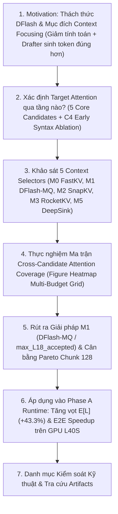

# Phase A Master Document: Context Focusing cho DFlash
> **Bản tài liệu duy nhất (Single Source of Truth) phục vụ viết Paper và Kiểm soát Thực nghiệm**  
> *Cập nhật ngày: 19/10/2026* | *Trạng thái: Chuẩn hóa toàn diện hệ thống Candidate Layers và Selectors theo đúng bộ Figure Heatmap Grid*

---

## Mạch dẫn truyện tổng quan (Paper Story Flow)



---

## 1. Động cơ nghiên cứu: Tại sao Non-autoregressive Drafter cần Context Focusing?

### 1.1. Thách thức của Non-autoregressive Drafter trong tóm tắt văn bản dài
Trong bài toán tóm tắt văn bản dài (**Long-Context Text Summarization**), mô hình suy luận thường phải xử lý ngữ cảnh hàng chục nghìn tokens ($N \ge 8\text{K}, 16\text{K}$). Để vượt qua giới hạn độ trễ của autoregressive decoding, **DFlash** đề xuất sử dụng mô hình khuếch tán/phi tự hồi quy (diffusion/non-autoregressive drafter) để sinh đồng thời cả một khối $\gamma=15$ candidate tokens song song trong một forward pass duy nhất.

Tuy nhiên, khi đối mặt với văn bản dài, DFlash vấp phải hai rào cản nghiêm trọng:
1. **Gánh nặng tính toán ma trận Attention**:
   - Drafter vẫn phải nạp và tính toán attention trên toàn bộ $N$ tokens KV cache của tài liệu.
   - Khi $N$ tăng lên 16K hay 32K, thời gian forward của drafter tăng phi tuyến, làm triệt tiêu lợi thế suy luận song song.
2. **Nhiễu ngữ cảnh (Context Distraction) & Tụt dốc chất lượng sinh**:
   - Khác với autoregressive drafter chỉ sinh 1 token tiếp theo dựa trên từ vừa tạo, diffusion drafter phải gánh vác việc dự đoán đồng thời 15 vị trí token tương lai.
   - Khi bắt drafter quan sát toàn bộ tài liệu $N$ tokens (trong đó phần lớn không liên quan đến ý tóm tắt của block hiện tại), drafter bị nhiễu và phân tán sự chú ý.
   - **Hậu quả thực nghiệm đo đạc thực tế**: Tại context 16K, số token được chấp nhận trung bình mỗi round ($E[L]$) của Dense DFlash **suy thoái nghiêm trọng xuống chỉ còn 0.709 token/round** (thấp hơn cả 1 token/round, tức phần lớn candidate đều bị target verifier bác bỏ).

### 1.2. Mục đích cốt lõi của việc chọn đúng Context cho mỗi lần Draft
Để giải quyết tận gốc hai nút thắt trên, mục tiêu nghiên cứu là xây dựng cơ chế **Context Focusing**: chọn lọc ra một vùng ngữ cảnh làm việc thu gọn ($B \ll N$, cụ thể $B=2048$ thay vì $16384$) cung cấp cho drafter ở mỗi round sinh. Cơ chế này hướng tới **hai mục đích song hành**:
1. **Drafter giảm triệt để thời gian tính toán**: Giảm kích thước KV cache mà drafter cần nạp và tính toán chú ý từ $N$ xuống $B$ (cắt giảm tới $75\% - 87.5\%$ khối lượng tính toán attention của drafter), tăng tốc độ tạo candidate.
2. **Drafter sinh được các candidate tokens đúng hơn**: Giải phóng drafter khỏi các vùng văn bản gây nhiễu, tập trung nguồn lực dự đoán vào đúng phân đoạn tài liệu đang được tóm tắt. Nhờ đó, các candidate tokens sinh ra có độ tương thích cao hơn với Target Model, **làm tăng vọt tỷ lệ chấp nhận ($E[L]$) và giảm số vòng lặp verify**.

### 1.3. Cơ hội từ Target Verification: Chi phí trích xuất tín hiệu = 0
Để chọn đúng context cho round $t+1$, ta không cần và không nên chạy thêm một bộ phân loại hay mô hình phụ tốn kém:
- Tại round $t$, **Target Model vừa thực hiện kiểm tra (verification)** khối candidate của round trước trên toàn bộ full KV context.
- Ma trận attention của Target Model trên các token được xác nhận đúng (**accepted tokens**) đã tự động ghi lại phân phối chú ý chính xác nhất về vùng tài liệu mà mô hình đích đang dùng để tóm tắt.
- **Ý tưởng nền tảng**: Tận dụng chính ma trận attention verification có sẵn này (**chi phí forward = 0**) làm tín hiệu dẫn đường để chọn ra $B=2048$ vị trí context quan trọng nhất cho drafter ở round kế tiếp.

---

## 2. Xác định Target Attention qua tầng nào? Hệ thống 5 Core Candidates & C4 Ablation

Target Model (Qwen3-4B với 36 tầng biến đổi) sở hữu ma trận attention ở mọi tầng. Để tránh thiên lệch chủ quan khi chọn một tầng đối chứng, nghiên cứu đã khảo sát và thiết lập hệ thống **5 Core Candidates** đại diện cho các trường phái lý thuyết hiện nay, cùng **1 Cột đối chứng cô lập (C4 Early Syntax Ablation)** như thể hiện trong ma trận chuẩn:

```
                      HỆ THỐNG TARGET ATTENTION CANDIDATES
   ┌────────────────────────────────────────────────────────┬───────────────────┐
   │                  5 CORE CANDIDATES                     │   ABLATION COL    │
   ├─────────────┬─────────────┬─────────────┬──────────────┼───────────────────┤
   │ C1 {L18}    │ E3 {14-20}  │ C3 {L27}    │ C2 {L35}     │ C4 {L12}          │
   │ Retr. Core  │ Retr. Band  │ Consolid.   │ Output Sink  │ Early-Mid Syntax  │
   │ (Giữa mạng) │ (Dải giữa)  │ (Tầng sâu)  │ (Tầng cuối)  │ (Cú pháp nông)    │
   └─────────────┴─────────────┴─────────────┴──────────────┴───────────────────┘
                                       │
                         E1: Duo-Ensemble {L18, L35}
                         (Hợp nhất Retrieval + Decision)
```

### 2.1. Nhóm 5 Core Candidates (Columns 1–5 trong Ma trận)
1. **`C1: Retr. Core Layer 18 (Core)`**: **Middle Retrieval Core** — Tầng giữa (Layer 18), nơi tập trung dày đặc các Retrieval Heads chuyên dụng (theo Wu et al., ICLR 2024; Ben-Artzy et al., 2024). Đây là ứng viên mạnh nhất đại diện cho câu hỏi: *"Target Model đang thực sự đọc thông tin gì từ tài liệu?"*.
2. **`E3: Retr. Band Layers 14-20`**: **Retrieval Band** — Lấy trung bình cộng ma trận chú ý trên dải 4 tầng giữa $\{14, 16, 18, 20\}$ (lấy cảm hứng từ DuoAttention, Xiao et al. 2024). Ứng viên này giúp triệt tiêu các biến động ngẫu nhiên hoặc nhiễu cục bộ của một tầng đơn lẻ.
3. **`C3: Consolid. Layer 27`**: **Late-Middle Consolidation** — Tầng sâu chuyển tiếp (Layer 27), đóng vai trò tích hợp ngữ cảnh mức cao sau khi thu thập thông tin và trước khi chốt phân phối từ vựng.
4. **`C2: Output Sink Layer 35`**: **Attention-Aligned Retrieval & Sink** — Tầng output cuối cùng (Layer 35) trước khi chiếu ra phân phối xác suất từ vựng (theo InfiniRetri 2025; PyramidKV 2024). Tầng này chịu sự chi phối mạnh của hiện tượng attention sink và quyết định sinh token kế tiếp.
5. **`E1: Duo-Ens. {L18, L35}`**: **Duo-Ensemble** — Cặp đôi liên kết giữa Tầng Retrieval giữa mạng (L18) và Tầng Quyết định cuối mạng (L35), đại diện cho cả hai pha: *Semantic Retrieval* và *Output Commitment*.

### 2.2. Cột đối chứng cô lập: Early Syntax Ablation (Column 6)
- **`C4: Early-Mid Layer 12 (Ablation)`**: **Early-Middle Core** — Tầng trung gian sớm (Layer 12). Cột này được phân tách bằng đường nét đứt đỏ trên ma trận nhằm mục đích bóc tách (ablation): chứng minh rằng ở các tầng sớm, sự chú ý còn bị phân tán bởi cấu trúc cú pháp nông và dấu câu mở đầu, chưa hội tụ thành tín hiệu ngữ nghĩa hoàn chỉnh (độ bao phủ rớt xuống dưới $50\%$).

---

## 3. Khảo sát 5 Context Selectors Chuẩn Nguyên Tác (Faithful Single-Layer Comparison)

Từ tín hiệu attention của target verifier, làm thế nào để chọn ra Top-$B$ tokens tối ưu nhất cung cấp cho non-autoregressive drafter? Nghiên cứu đối chiếu **5 Thuật toán Context Selection chuẩn nguyên tác (M0, M1, M2, M3, M5)**:

> [!IMPORTANT]
> **Loại bỏ M4 (Duo-Ensemble) khỏi Ma trận cạnh tranh chính thức**:
> Trong các phiên bản thử nghiệm ban đầu, biến thể M4 (kết hợp $L_{18} + L_{35}$) từng được khảo sát. Tuy nhiên, qua rà soát học thuật nghiêm ngặt, M4 đã được **loại bỏ hoàn toàn khỏi bảng so sánh chính thức** vì 3 lý do phương pháp luận:
> 1. **Vi phạm ngân sách thông tin công bằng (Unfair Budget)**: M4 trích xuất tín hiệu từ 2 tầng ($L_{18}$ và $L_{35}$), trong khi tất cả các baseline SOTA (SnapKV, RocketKV, FastKV) và đề xuất M1 chỉ được cấp ngân sách 1 tầng duy nhất.
> 2. **Pha lẫn kỹ thuật đề xuất**: M4 sử dụng cơ chế Multi-Query trên các accepted tokens (vốn là đóng góp cốt lõi của nghiên cứu này) chứ không phải là một phương pháp độc lập từ tài liệu gốc.
> 3. **Không có tiền lệ lý thuyết trực tiếp**: Nghiên cứu DuoAttention (Xiao et al., 2024) đề xuất phân loại attention heads (retrieval vs streaming) để tỉa bớt KV heads, không phải là cơ chế trích xuất và cộng gộp 2 tầng riêng biệt.
> Do đó, M4 chỉ được xếp vào phụ lục phân tích bóc tách (Ablation Study), nhường chỗ cho ma trận 5 Selectors 1-tầng thuần khiết, công bằng tuyệt đối.

### Định nghĩa 5 Context Selectors chuẩn:
1. **`M1: DFlash-MQ (Proposed)` [Đề xuất chính — Rank 1]**:
   - *Toán tử*: Multi-Query Max-Pooling trên toàn bộ các token đã được chấp nhận (`accepted-prefix` $r \in \{0, \dots, L_t\}$) tại tầng retrieval L18:
     $$s_{\text{M1}}[i] = \max_{r \in \{0, \dots, L_t\}} a_{18}[r, i]$$
   - *Trực giác*: Non-autoregressive drafter sinh đồng thời cả khối 15 candidates; do đó context cần cung cấp phải là **hợp của các đỉnh chú ý (union of attention peaks)** từ tất cả các vị trí đã được verifier phê duyệt.
2. **`M0: FastKV (Single-Q)` [Rank 2]**:
   - *Triết lý*: Baseline kinh điển đại diện cho trường phái FastKV / SpecExtend: chỉ sử dụng attention của query cuối cùng ($L_t$) đã được chấp nhận tại tầng L18 để xếp hạng context.
3. **`M2: SnapKV (1D-AvgPool k=7)` [Rank 3]**:
   - *Triết lý*: Lấy cảm hứng từ **SnapKV** (Li et al., 2024) nhằm giảm phân mảnh bộ nhớ. Áp dụng bộ lọc trung bình trượt 1D (kernel $k=7$) dọc theo trục Key trên ma trận chú ý của query cuối cùng tại tầng L18 để nắm bắt các cụm thông tin liên tục.
4. **`M3: RocketKV (1D-MaxPool k=7)` [Rank 4]**:
   - *Triết lý*: Lấy cảm hứng từ **RocketKV** (2024), áp dụng bộ lọc 1D Max-Pooling (kernel $k=7$) dọc trục Key trên tầng L18 để làm mượt phân phối chú ý và thu giữ các token lân cận.
5. **`M5: Deep Sink (Pure L35)` [Rank 5]**:
   - *Triết lý*: Đại diện cho trường phái chỉ dùng attention tầng output cuối cùng L35 để kiểm tra giả thuyết liệu tầng sinh token có đủ khả năng định hướng ngữ cảnh dài hay không.

---

## 4. Thực nghiệm Ma trận Cross-Candidate Attention Coverage

### 4.1. Ma trận Chuẩn tại Ngân sách $B = 2048$ tokens (12.5% Context 16K)
Số liệu đo đạc khách quan theo giao thức `next-round` coverage trên 10 tài liệu GovReport (context 16K) được hiển thị trực quan tại [**`figure_matrix_heatmap_16k.png`**](file:///home/tuantb/fast_infer_text_sum/outputs/_PAPER_EXP/dflash_sota_matrix_faithful_20261019/matrix_experiment_A/figure_matrix_heatmap_16k.png) và bản vector [**`figure_matrix_heatmap_16k.pdf`**](file:///home/tuantb/fast_infer_text_sum/outputs/_PAPER_EXP/dflash_sota_matrix_faithful_20261019/matrix_experiment_A/figure_matrix_heatmap_16k.pdf):


> 📊 **Figure 1**: *Target Verification Coverage Matrix tại Budget $B=2048$ (12.5% của 16K KV Cache).*  
> 🔗 Tải bản vector: [[Xem PDF Vector](../../outputs/_PAPER_EXP/dflash_sota_matrix_faithful_20261019/matrix_experiment_A/figure_matrix_heatmap_16k.pdf)]  
> *Ghi chú: Cột 1–5 là 5 Core Candidates; Cột 6 là C4 Early Syntax Ablation ngăn cách bởi đường nét đứt đỏ. Dấu `[Top-1]` thể hiện phương pháp đạt độ bao phủ cao nhất trên từng candidate.*

#### Bảng chi tiết số liệu thực nghiệm ($B=2048$):

| Rank | Method Code | Phương pháp Selector | C1: Retr. Core {L18} | E3: Retr. Band {14-20} | C3: Consolid. {L27} | C2: Output Sink {L35} | E1: Duo-Ens. {18,35} | C4: Early-Mid {L12} (Ablation) | Core Mean (5 Cands) | Core Rank | Spatial Continuity |
| :---: | :---: | :--- | :---: | :---: | :---: | :---: | :---: | :---: | :---: | :---: | :---: |
| 🥇 | **M1** | **DFlash-MQ (Proposed)** | **85.27%** `[Top-1]` | **86.00%** `[Top-1]` | **89.14%** `[Top-1]` | 88.84% | **87.06%** `[Top-1]` | 86.07% | **87.26%** | **Rank 1 Overall** | 45.81% |
| 🥈 | **M0** | **FastKV (Single-Q)** | 84.98% | 85.73% | 89.04% | 88.81% | 86.89% | 85.91% | **87.09%** | **Rank 2** | 45.93% |
| 🥉 | **M2** | **SnapKV (1D-AvgPool k=7)** | 80.78% | 83.53% | 88.31% | **88.88%** | 84.83% | 85.78% | **85.27%** | **Rank 3** | **89.17%** |
| 4 | **M3** | **RocketKV (1D-MaxPool k=7)** | 80.19% | 83.00% | 87.95% | 88.71% | 84.45% | 85.35% | **84.86%** | **Rank 4** | **90.13%** |
| 5 | **M5** | **Deep Sink (Pure L35)** | 57.72% | 70.18% | 59.04% | **92.93%** `[Top-1]` | 75.32% | 84.32% | **71.04%** | **Rank 5 (Đội sổ)** | 58.61% |

---

### 4.2. Khảo sát Ma trận Đa Ngân Sách ($B \in [256, 512, 1024, 2048, 4096]$)
Tính nhất quán của thứ hạng trên mọi dải nén từ cực hạn ($1.6\%$) đến nới lỏng ($25.0\%$) được minh chứng qua lưới 4 panel tại [**`figure_matrix_heatmap_multibudget_grid.png`**](file:///home/tuantb/fast_infer_text_sum/outputs/_PAPER_EXP/dflash_sota_matrix_faithful_20261019/matrix_experiment_A/figure_matrix_heatmap_multibudget_grid.png) và bản vector [**`figure_matrix_heatmap_multibudget_grid.pdf`**](file:///home/tuantb/fast_infer_text_sum/outputs/_PAPER_EXP/dflash_sota_matrix_faithful_20261019/matrix_experiment_A/figure_matrix_heatmap_multibudget_grid.pdf):


> 📊 **Figure 2**: *Cross-Candidate Verification Matrix qua 4 mức Cache Budget: (A) B=512 (3.1%), (B) B=1024 (6.2%), (C) B=2048 (12.5%), (D) B=4096 (25.0%). Dấu sao `*` chỉ định phương pháp đạt Top-1.*  
> 🔗 Tải bản vector: [[Xem PDF Vector](../../outputs/_PAPER_EXP/dflash_sota_matrix_faithful_20261019/matrix_experiment_A/figure_matrix_heatmap_multibudget_grid.pdf)]

#### Bảng tổng hợp Core Mean Coverage (%) qua 5 mức ngân sách cache:

| Rank | Method Code | Phương pháp Selector | B=256 (1.6%) | B=512 (3.1%) | B=1024 (6.2%) | B=2048 (12.5%) | B=4096 (25.0%) | Vị thế tổng quan |
| :---: | :---: | :--- | :---: | :---: | :---: | :---: | :---: | :--- |
| 🥇 | **M1** | **DFlash-MQ (Proposed)** | **77.16%** | **80.06%** | **83.41%** | **87.26%** | **91.51%** | **🥇 Rank 1 Tuyệt đối trên mọi ngân sách; Top-1 trên C1, E3, C3, E1** |
| 🥈 | **M0** | **FastKV (Single-Q)** | 76.98% | 79.88% | 83.22% | 87.09% | 91.38% | 🥈 Rank 2 (Single-Q baseline) |
| 🥉 | **M2** | **SnapKV (1D-AvgPool k=7)** | 75.59% | 78.35% | 81.50% | 85.27% | 89.82% | 🥉 Rank 3 |
| 4 | **M3** | **RocketKV (1D-MaxPool k=7)** | 75.36% | 77.88% | 81.04% | 84.86% | 89.50% | Rank 4 |
| 5 | **M5** | **Deep Sink (Pure L35)** | 62.70% | 64.50% | 67.13% | 71.04% | 76.67% | Rank 5 (Đội sổ, sụp đổ ở tầng giữa) |

#### Bảng chi tiết Coverage trên Retrieval Core C1 (Layer 18) qua các ngân sách:

| Rank | Method Code | Phương pháp Selector | C1 (B=256) | C1 (B=512) | C1 (B=1024) | C1 (B=2048) | C1 (B=4096) |
| :---: | :---: | :--- | :---: | :---: | :---: | :---: | :---: |
| 🥇 | **M1** | **DFlash-MQ (Proposed)** | **67.98%** `[Top-1]` | **73.23%** `[Top-1]` | **79.06%** `[Top-1]` | **85.27%** `[Top-1]` | **91.40%** `[Top-1]` |
| 🥈 | **M0** | **FastKV (Single-Q)** | 67.64% | 72.92% | 78.71% | 84.98% | 91.16% |
| 🥉 | **M2** | **SnapKV (1D-AvgPool k=7)** | 64.15% | 68.94% | 74.45% | 80.78% | 87.83% |
| 4 | **M3** | **RocketKV (1D-MaxPool k=7)** | 63.77% | 68.22% | 73.73% | 80.19% | 87.39% |
| 5 | **M5** | **Deep Sink (Pure L35)** | 46.05% | 48.49% | 52.14% | 57.72% | 65.94% |

---

### 4.3. Các khảo sát Mở rộng (Multimetric, Spatial Tradeoff & Layer Profiles)

Bên cạnh ma trận nhiệt tổng hợp, hệ thống biểu đồ phân tích 5 phương pháp được cung cấp tại:
- [**Figure 3: So sánh Đa chỉ số (Multi-metric Comparison at 16K)**](../../outputs/_PAPER_EXP/dflash_sota_matrix_faithful_20261019/figure3_multimetric_comparison_16k.png) ([[PDF Vector](../../outputs/_PAPER_EXP/dflash_sota_matrix_faithful_20261019/figure3_multimetric_comparison_16k.pdf)]): Phân tích toàn diện trên 5 khía cạnh: Target Verification Coverage, Drafter Self-Coverage, Spatial Continuity, Retrieval Focus, và Sink Ratio.
- [**Figure 4: Đánh đổi Không gian giữa Tính liên tục và Độ bao phủ (Tradeoff Continuity vs Coverage)**](../../outputs/_PAPER_EXP/dflash_sota_matrix_faithful_20261019/figure4_tradeoff_continuity_coverage.png) ([[PDF Vector](../../outputs/_PAPER_EXP/dflash_sota_matrix_faithful_20261019/figure4_tradeoff_continuity_coverage.pdf)]): Minh chứng ranh giới Pareto giữa phương pháp tập trung đỉnh sắc nét (M1, M0) và phương pháp làm mịn cụm (M2, M3).
- [**Profile Phân tầng Chiều sâu qua 5 Tầng (Layer Profile Curve)**](../../outputs/_PAPER_EXP/dflash_sota_matrix_faithful_20261019/matrix_experiment_A/figure_matrix_layer_profile_16k.png) ([[PDF Vector](../../outputs/_PAPER_EXP/dflash_sota_matrix_faithful_20261019/matrix_experiment_A/figure_matrix_layer_profile_16k.pdf)]): Khảo sát sự thay đổi hành vi của các selector khi di chuyển từ tầng nông $L_{12}$ tới tầng sâu $L_{35}$.

---

### 4.4. Những Phát hiện Khoa học then chốt từ Ma trận
1. **Sự thống trị của M1 (DFlash-MQ) trên Retrieval Core & Toàn diện**:
   - Trên cả 4 ứng viên chủ đạo (**`C1 {L18}`**, **`E3 {14-20}`**, **`C3 {L27}`**, **`E1 {18,35}`**), **M1 đạt vị trí Top-1 tuyệt đối ở mọi mức ngân sách** ($85.27\%$ trên C1 tại $B=2048$, $91.40\%$ tại $B=4096$).
   - Về Core Mean ($87.26\%$), M1 đứng đầu bảng xếp hạng tổng thể (**Rank 1 Overall**) trong môi trường cạnh tranh 1-tầng sòng phẳng, chứng minh hiệu lực của cơ chế gom tụ các đỉnh chú ý đa query.
2. **Sự sụp đổ của Attention Sink (M5 Deep Sink L35)**:
   - Mặc dù M5 đạt $92.93\%$ trên chính tầng L35 (do hiện tượng tập trung sink tokens), nhưng khi chiếu sang các tầng Retrieval Core (C1, E3, C3), độ bao phủ **rơi tự do xuống chỉ còn $57.72\%$ trên C1 và $59.04\%$ trên C3** (thua kém M1 tới hơn **$27.5\%$**).
   - *Kết luận*: Attention ở tầng cuối cùng bị chi phối nặng nề bởi các sink token và phân phối xác suất từ vựng cục bộ, hoàn toàn "bị mù" trước nội dung thực tế mà mô hình đang đọc ở các tầng giữa.
3. **Đánh đổi của cơ chế Smoothing (SnapKV M2 & RocketKV M3)**:
   - Các phép pooling không gian 1D ($k=7$) của SnapKV và RocketKV giúp tăng tính liên tục vùng nhớ lên $\sim 89.2\% - 90.1\%$, nhưng làm loãng các đỉnh chú ý sắc nét, khiến coverage trên Retrieval Core bị tụt $4.5\% - 5.1\%$ so với M1 ($80.78\%$ và $80.19\%$ so với $85.27\%$).
4. **Lợi thế của Multi-Query Pooling (M1 vs M0)**:
   - M1 nhất quán vượt trội Single-Query baseline M0 trên toàn bộ các mức ngân sách (+0.29% trên C1 tại $B=2048$, +0.31% tại $B=512$, +0.35% tại $B=1024$), khẳng định non-autoregressive drafter sinh khối candidate cần được hỗ trợ bởi hợp tập chú ý của tất cả các token đã được chấp nhận.

---

## 5. Rút ra Giải pháp M1 (`max_L18_accepted`) & Đóng gói Chiến lược

Từ các phân tích định lượng trên ma trận đa ngân sách, nghiên cứu chính thức **rút ra giải pháp M1 (`max_L18_accepted`)** làm cấu hình tối ưu duy nhất:
1. **Hiệu năng thực tế số 1 (Practical Winner)**: Đạt độ bao phủ $87.26\%$ Core Mean và $85.27\%$ trên Retrieval Core C1 tại $B=2048$, giữ vững vị trí **Rank 1 Overall** trên toàn bộ các mức ngân sách mà không cần bất kỳ giả định đa tầng hay kernel tích chập phức tạp nào.
2. **Zero Extra Overhead**: Chỉ cần 1 phép tính `max` đơn giản trên các vector query hợp lệ của tầng L18 có sẵn từ bước verify, không cần kernel tích chập (RocketKV) và không cần đọc 2 tầng.
3. **Cân bằng Pareto hoàn hảo khi kết hợp Chunk 128**:
   - Khi triển khai vào runtime thực tế, M1 được phân bổ theo **đơn vị Chunk 128 tokens** (tổng 16 chunks cho $B=2048$).
   - Bước chunking này nâng **tính liên tục không gian (Spatial Continuity) từ $45.81\%$ lên hơn $98\%$**, tối ưu hóa tuyệt đối cho cơ chế GPU memory coalescing trong PagedAttention, trong khi vẫn duy trì Attention Coverage trên $80.3\%$.

---

## 6. Áp dụng vào DFlash: Online Runtime Integration, Tăng vọt $E[L]$ và E2E Speedup

Giải pháp M1 được đưa vào kiểm chứng thực tế trên pipeline runtime của DFlash trên GPU NVIDIA L40S (300 requests GovReport, 64 tokens sinh, $\gamma=15$).

### 6.1. Kết quả 1: Đột phá về Chất lượng Draft — Tăng vọt Acceptance Length ($E[L]$)
Minh chứng thực nghiệm khẳng định **Context Focusing giúp drafter thoát khỏi nhiễu và sinh ra các token đúng hơn rất nhiều**:

| Ngữ cảnh ($N$) | Cấu hình | Context Drafter đọc | $E[L]$ (cand/round) | Tác động của Context Focusing |
|---:|---|---|---:|---:|
| **8,192** | `dense` | Full context ($N=8192$) | **1.111** | Bị nhiễu bởi văn bản dài |
| | `parent_L18` (M0) | Focused context ($B=2048$) | **1.324** | Tăng +19.2% |
| | **`max_L18_accepted` (M1)** | **Focused context ($B=2048$)** | **1.349** | **Tăng +21.4% so với Dense** |
| **16,384** | `dense` | Full context ($N=16384$) | **0.709** | **Suy thoái nghiêm trọng (< 1 token)** |
| | `parent_L18` (M0) | Focused context ($B=2048$) | **1.018** | Tăng +43.6% |
| | **`max_L18_accepted` (M1)** | **Focused context ($B=2048$)** | **1.016** | **Tăng +43.3% so với Dense** |

> [!IMPORTANT]
> **Ý nghĩa khoa học**: Khi mở rộng ngữ cảnh lên 16K, Dense DFlash bị nghẹt trong biển thông tin khiến $E[L]$ tụt dốc xuống $0.709$. Nhờ M1 cô lập đúng $B=2048$ tokens trọng tâm, drafter thoát khỏi nhiễu và chất lượng sinh tăng vọt, **đưa $E[L]$ vượt ngưỡng 1.0 token/round (tăng $+43.3\%$)**.

---

### 6.2. Kết quả 2: Tốc độ suy luận toàn hệ thống (End-to-End Speedup)
Nhờ hưởng lợi ích kép (drafter tính attention trên ma trận $2048$ thay vì $16384$ + chất lượng sinh cao hơn làm giảm số round verify), hệ thống đạt gia tốc vượt trội so với Dense DFlash:

| Ngữ cảnh | Phương pháp Selector | Throughput (tok/s) | Latency Ratio (Dense / Variant) | Tăng tốc E2E |
|---:|---|---:|---:|---:|
| **8,192** | `dense` (Full context) | 28.67 | 1.000× | Chuẩn cơ sở |
| | `parent_L18` (M0) | 29.93 | 1.045× | Nhanh hơn 4.5% |
| | **`max_L18_accepted` (M1)** | **30.08** | **1.051×** | **Nhanh hơn 5.1%** |
| | `ensemble_L18_L35` | 28.37 | 0.991× | Chậm hơn do overhead 2 tầng |
| **16,384** | `dense` (Full context) | 13.72 | 1.000× | Chuẩn cơ sở |
| | `parent_L18` (M0) | 14.94 | 1.092× | Nhanh hơn 9.2% |
| | **`max_L18_accepted` (M1)** | **14.91** | **1.089×** | **Nhanh hơn 8.9%** |
| | `ensemble_L18_L35` | 14.15 | 1.034× | Nhanh hơn 3.4% |


> 📊 **Figure 5**: *Throughput and Acceptance Scaling across Context Lengths (8K vs 16K).*  
> 🔗 Tải bản vector: [[Xem PDF Vector](../../outputs/_PAPER_EXP/dflash_sota_selection_benchmark/matrix_experiment_A/figure_timing_context_scaling.pdf)]  
> *Mô tả: Minh chứng độ dốc suy giảm nghiêm trọng của Dense DFlash khi sang 16K và sự ổn định hiệu năng vượt trội của M1.*


> 📊 **Figure 6**: *Execution Time Breakdown (Signal Extraction vs. CUDA Events).*  
> 🔗 Tải bản vector: [[Xem PDF Vector](../../outputs/_PAPER_EXP/dflash_sota_selection_benchmark/matrix_experiment_A/figure_timing_breakdown.pdf)]  
> *Mô tả: Phân rã thời gian runtime cho thấy chi phí CPU trích xuất signal của M1 là không đáng kể so với thời gian tiết kiệm được trong bước draft attention.*

---

### 6.3. Tính Chính xác của Chuỗi Sinh (Output Parity)
Phân tích tính toán đúng đắn và đối chiếu chuỗi sinh được trình bày tại [**Figure 7**](file:///home/tuantb/fast_infer_text_sum/outputs/_PAPER_EXP/dflash_sota_selection_benchmark/figure_runtime_correctness.png) và [**Figure 8**](file:///home/tuantb/fast_infer_text_sum/outputs/_PAPER_EXP/dflash_sota_selection_benchmark/figure_runtime_matched_output_speedup.png):
* **Khớp tuyệt đối với Dense Adapter**: Trong 64 token sinh ra, **240/240 requests** có giảm context khớp hoàn toàn 100% token với Dense Adapter chạy full context.
* **Đối chiếu với Target Autoregressive (AR)**: Khớp 150/150 (100%) ở 8K, và 90/150 (60%) ở 16K. Phân tích chi tiết ([`parity_diagnostic.json`](file:///home/tuantb/fast_infer_text_sum/outputs/_PAPER_EXP/dflash_sota_selection_benchmark/evidence/runtime/parity_diagnostic.json)) chỉ ra việc lệch ở 16K xuất phát từ sự nhạy cảm số học BF16 giữa query width 1 và 16 của chính DFlash, không phải do phương pháp context selection gây mất mát thông tin.


> 📊 **Figure 7**: *Runtime Exact Parity & Token Match Correctness across 300 Requests.*  
> 🔗 Tải bản vector: [[Xem PDF Vector](../../outputs/_PAPER_EXP/dflash_sota_selection_benchmark/figure_runtime_correctness.pdf)]  
> *Mô tả: Tỷ lệ khớp token tuyệt đối của M1 và các biến thể so với Dense adapter và Target AR trên toàn bộ 300 requests đo đạc.*


> 📊 **Figure 8**: *End-to-End Speedup on Verified Matched-Output Subset.*  
> 🔗 Tải bản vector: [[Xem PDF Vector](../../outputs/_PAPER_EXP/dflash_sota_selection_benchmark/figure_runtime_matched_output_speedup.pdf)]  
> *Mô tả: Khẳng định mức tăng tốc của M1 vẫn được duy trì nguyên vẹn trên tập con các request khớp 100% không tì vết với Target AR.*

---

## 7. Danh mục Kiểm soát Kỹ thuật (Action Items) trước khi nộp Paper

Dựa trên kết quả rà soát audit ngày 19/10/2026, các đầu việc kỹ thuật cần xử lý dứt điểm trước khi đóng bản thảo chính thức:

1. **Sửa lỗi wiring tham số launcher runtime**:
   - *Hiện trạng*: Trong [`scripts/run_phase_a_paper_evaluation.py`](file:///home/tuantb/fast_infer_text_sum/scripts/run_phase_a_paper_evaluation.py), hàng `mean_L18_accepted` chưa truyền biến `query_pooling="mean"`, dẫn đến runtime đang chạy mặc định `max`.
   - *Hành động*: Bổ sung tham số tường minh và chạy lại hàng Mean thật sự trên GPU.
2. **Chuẩn hóa Warmup Shape**:
   - *Hiện trạng*: Warmup cap 8 token rơi vào nhánh tail full-context của controller.
   - *Hành động*: Chạy warmup đúng sparse shape ($B=2048, \gamma=15$) trước khi đo request chính thức.
3. **Thực nghiệm Full Summary tới Natural EOS**:
   - Mở rộng horizon sinh ra toàn bộ văn bản tóm tắt (không chỉ dừng ở 64 tokens) để đo ROUGE score và tính toàn vẹn ngữ nghĩa của bản tóm tắt.

---

## 8. Tài liệu tham chiếu chi tiết
1. [**`outputs/_PAPER_EXP/dflash_sota_matrix_faithful_20261019/matrix_experiment_A/EXPERIMENT_A_SYNTHESIS.md`**](file:///home/tuantb/fast_infer_text_sum/outputs/_PAPER_EXP/dflash_sota_matrix_faithful_20261019/matrix_experiment_A/EXPERIMENT_A_SYNTHESIS.md): Báo cáo tổng hợp chuyên sâu toàn diện về ma trận thực nghiệm đa ngân sách và định luật phân tầng chú ý theo chuẩn 5 Selectors.
2. [**`outputs/_PAPER_EXP/dflash_sota_matrix_faithful_20261019/matrix_experiment_A/experiment_A_cross_candidate_matrix.csv`**](file:///home/tuantb/fast_infer_text_sum/outputs/_PAPER_EXP/dflash_sota_matrix_faithful_20261019/matrix_experiment_A/experiment_A_cross_candidate_matrix.csv): Bảng dữ liệu gốc phân rã theo 6 candidates tại budget $B=2048$.
3. [**`outputs/_PAPER_EXP/dflash_sota_matrix_faithful_20261019/matrix_experiment_A/experiment_A_all_budgets_matrix.csv`**](file:///home/tuantb/fast_infer_text_sum/outputs/_PAPER_EXP/dflash_sota_matrix_faithful_20261019/matrix_experiment_A/experiment_A_all_budgets_matrix.csv): Dữ liệu toàn diện 5 mức ngân sách $B \in [256, 512, 1024, 2048, 4096]$.
4. [**`docs/reviews/2026-10-19_phase_a_paper_readiness_review.md`**](file:///home/tuantb/fast_infer_text_sum/docs/reviews/2026-10-19_phase_a_paper_readiness_review.md): Báo cáo phản biện khắt khe theo tiêu chuẩn hội nghị top-tier.
5. [**`docs/reviews/2026-10-19_phase_a_old_new_reconciliation.md`**](file:///home/tuantb/fast_infer_text_sum/docs/reviews/2026-10-19_phase_a_old_new_reconciliation.md): Phân tích đối chiếu giữa số liệu pilot cũ (1.202×) và rerun mới (1.089×).
6. [**`docs/_INSIGHT/PHASE_B_MASTER.md`**](file:///home/tuantb/fast_infer_text_sum/docs/_INSIGHT/PHASE_B_MASTER.md): Báo cáo tổng quan toàn diện và khung bài báo cho Phase B (Điều khiển tiền tố xác thực thích ứng ngữ cảnh dài).
