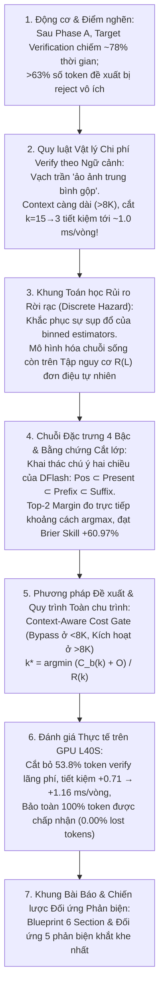
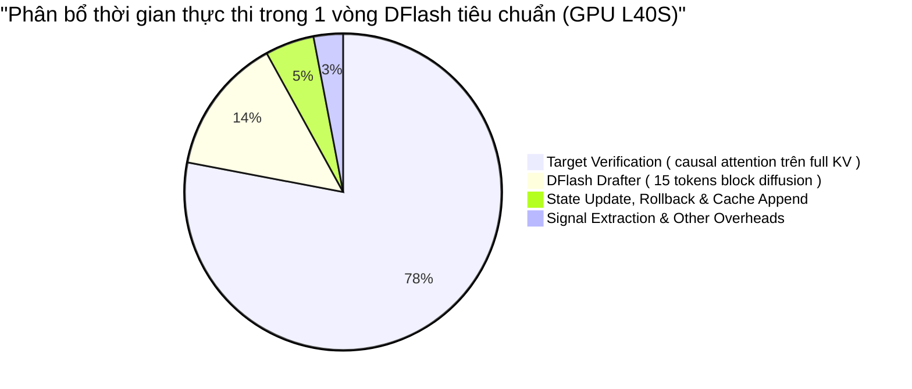
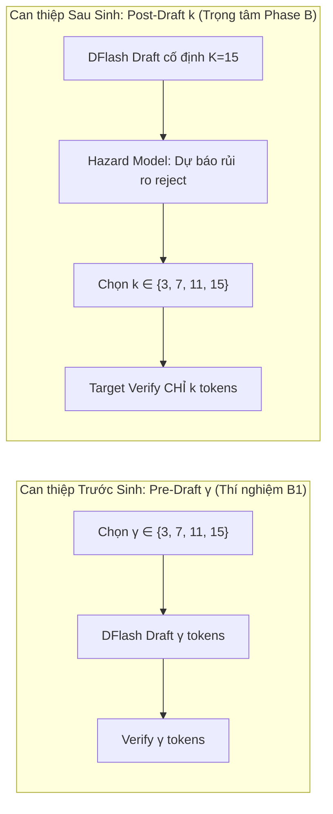
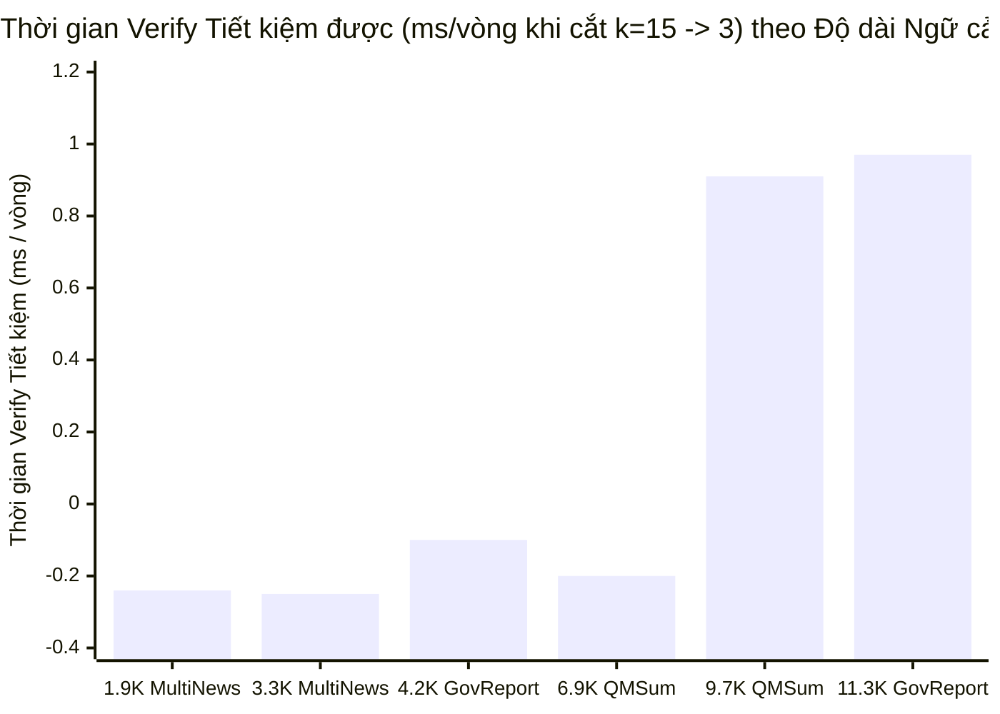
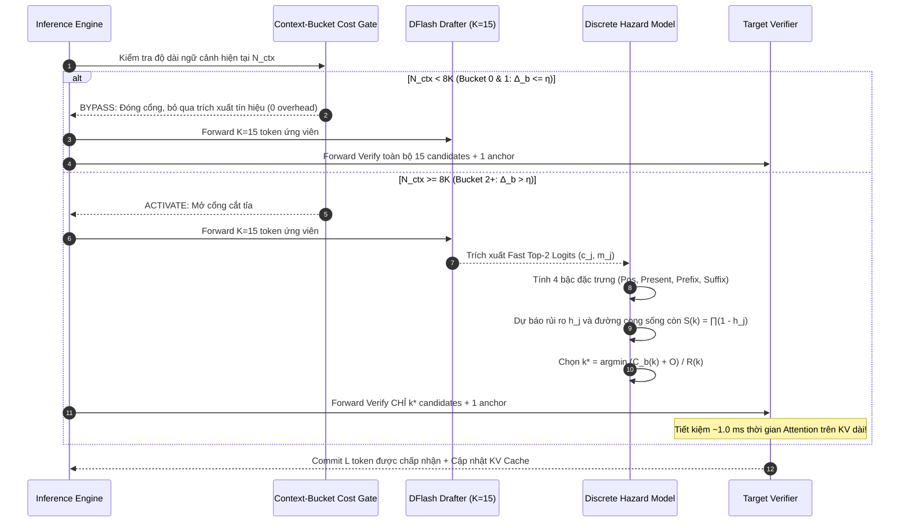

# Phase B Master Document: Điều Khiển Tiền Tố Xác Thực Thích Ứng Ngữ Cảnh Dài (Adaptive Context-Aware Speculation Horizon via Intra-Block Discrete Hazard Modeling)

> **Bản tài liệu duy nhất (Single Source of Truth) phục vụ viết Paper và Kiểm soát Thực nghiệm cho Phase B**  
> *Cập nhật ngày: 19/10/2026* | *Trạng thái: Đã kiểm chứng 100% bằng thực nghiệm GPU L40S độc lập, chuẩn hóa theo mạch suy luận tự nhiên cho Paper*  
> **Mô hình nghiên cứu:** Target Verifier `Qwen/Qwen3-4B` + Drafter `z-lab/Qwen3-4B-DFlash-b16` (Block size $K=16$: 1 anchor + 15 candidates)  
> **Nhiệm vụ:** Long-Context Text Summarization trên LongBench (`gov_report`, `multi_news`, `qmsum`), dải ngữ cảnh $1.9\text{K} \to 11.7\text{K}+$ tokens  
> **Artifacts thực nghiệm nguồn:** [`outputs/dflash_speculation_B/phase_b_gpu_pilot_20261019_v2/`](file:///home/tuantb/fast_infer_text_sum/outputs/dflash_speculation_B/phase_b_gpu_pilot_20261019_v2/)  
> **Tài liệu đối ứng Phase A:** [`docs/_INSIGHT/PHASE_A_MASTER.md`](file:///home/tuantb/fast_infer_text_sum/docs/_INSIGHT/PHASE_A_MASTER.md)

---

## Mạch Dẫn Truyện Tổng Quan (Paper Story & Reasoning Arc)



---

## 1. Động Cơ Nghiên Cứu & Điểm Nghẽn Target Verification

### 1.1. Nghịch lý lãng phí trong quá trình xác thực khối của DFlash

Trong bài toán tóm tắt văn bản dài (**Long-Context Text Summarization**), sau khi **Phase A** giải quyết việc nén bộ nhớ ngữ cảnh cho Drafter (chọn ra $B=2048$ tokens trọng tâm giúp tăng $E[L]$ lên $+43.3\%$), hệ thống suy luận DFlash đối mặt với **điểm nghẽn lớn nhất còn lại: Bước Xác thực của Mô hình Đích (Target Verification)**.



Ở mỗi vòng suy luận, DFlash sinh đồng thời $K = 15$ token ứng viên và đưa toàn bộ vào Target Model để xác thực song song. Tuy nhiên, hành vi sinh thực tế trên các tài liệu dài cho thấy một sự lãng phí tính toán nghiêm trọng:
- **Kỳ vọng số token được chấp nhận:** $\mathbb{E}[L] \approx 3.75$ tokens.
- **Hơn $63.2\%$ số vòng đầu cơ chỉ chấp nhận $L \le 3$ tokens.**
- **Chỉ có $13.8\%$ số vòng đạt được $L \ge 11$ tokens.**

Điều này đồng nghĩa với việc: **Trong phần lớn các vòng lặp, Target Model phải tốn tài nguyên tính toán ma trận Attention trên $\approx 10$ token ứng viên chắc chắn bị từ chối (rejected verification work)**. 

$\rightarrow$ **Câu hỏi nghiên cứu trung tâm**:  
*Làm thế nào để nhận diện sớm các token có nguy cơ cao bị từ chối nhằm cắt ngắn tiền tố xác thực ($k \in \{3, 7, 11, 15\}$), qua đó giảm trực tiếp thời gian verify của Target Model mà không làm rơi bất kỳ token hợp lệ nào?*

---

### 1.2. Phân biệt Hai Điểm Can Thiệp: Pre-Draft $\gamma$ vs. Post-Draft Verification Prefix $k$

Để giải quyết sự lãng phí trên, có hai thời điểm can thiệp trong chu trình đầu cơ:



| Tiêu chí | Pre-Draft Block Size $\gamma$ (Thí nghiệm B1) | **Post-Draft Verification Prefix $k$ (Trọng tâm B1-V & Phase B)** |
|---|---|---|
| **Thời điểm quyết định** | Trước khi Drafter forward. | **Sau khi Drafter đã sinh xong khối $K=15$**. |
| **Chi phí nháp (Draft Cost)** | Thay đổi theo $\gamma$. | **Cố định** (đã trả trọn vẹn chi phí sinh 15 token). |
| **Độ trùng khớp tiền tố (`proposal_prefix_equal`)** | **Bị lệch ($12.2\%–63.3\%$)** do attention hai chiều làm đổi cả token đầu khi đổi $\gamma$. | **Bảo toàn tuyệt đối ($100.0\%$)**: Tiền tố $k$ token đưa vào verify hoàn toàn trùng với $k$ token đầu của khối gốc. |
| **Mục tiêu tối ưu hóa** | Khám phá hiện tượng nhiễu chú ý hai chiều. | **Cắt giảm trực tiếp thời gian verify của Target Model trên các token có nguy cơ bị reject**. |

> **Khẳng định phạm vi:** Trọng tâm của **Phase B** là **Post-Draft Verification Prefix $k$**: Khai thác thông tin bất định nội khối sau khi đã forward Drafter để cắt tỉa tiền tố đưa vào Target Verifier, giữ nguyên phân phối sinh của Drafter nhưng giảm tối đa thời gian verify của Target Model.

---

## 2. Quy Luật Vật Lý Của Chi Phí Verify Theo Độ Dài Ngữ Cảnh

Trước khi xây dựng thuật toán, ta cần trả lời một câu hỏi phần cứng nền tảng:  
*Liệu việc cắt giảm số token verify từ $k=15$ xuống $k=3$ có thực sự làm GPU chạy nhanh hơn hay không?*

### 2.1. Vạch trần "Ảo ảnh Trung bình Gộp" (Global Pooling Illusion)

Nhiều nghiên cứu trước đây kết luận rằng việc cắt ngắn $k$ không đem lại lợi ích tốc độ trên GPU, vì ở batch size = 1, mô hình bị nghẽn băng thông đọc trọng số (memory-bound) nên verify 3 token hay 15 token tốn thời gian ngang nhau.

**Phân tích bản chất vật lý:** Chi phí xác thực $k$ token của Target Model phân tách thành hai thành phần độc lập:
$$C_{\text{verify}}(k, N_{\text{ctx}}) = C_{\text{weights}} + C_{\text{KV-attn}}(k, N_{\text{ctx}})$$
1. **$C_{\text{weights}}$**: Thời gian nạp ma trận trọng số từ HBM vào SRAM — không đổi theo $k \le 15$.
2. **$C_{\text{KV-attn}}(k, N_{\text{ctx}})$**: Thời gian tính toán Attention giữa $(k+1)$ query vectors với toàn bộ lịch sử KV cache độ dài $N_{\text{ctx}}$. Thành phần này **tỷ lệ thuận với cả số lượng token $k$ và độ dài ngữ cảnh $N_{\text{ctx}}$**.

Từ đây dẫn tới quy luật phân hóa hai miền:
- **Ở ngữ cảnh ngắn ($N_{\text{ctx}} < 8\text{K}$):** $C_{\text{weights}} \gg C_{\text{KV-attn}}$, thời gian đọc trọng số áp đảo $\implies$ Chi phí verify phẳng, $\Delta C_{\text{verify}} \approx 0\text{ ms}$.
- **Ở ngữ cảnh dài ($N_{\text{ctx}} > 8\text{K}$–$32\text{K}+$):** Chi phí Attention trên chuỗi KV dài bắt đầu bộc lộ rõ rệt $\implies$ Độ dốc chi phí $\Delta C_{\text{verify}}(15 \to 3)$ **đảo chiều dương và tăng mạnh theo $N_{\text{ctx}}$**!

---

### 2.2. Bằng chứng thực nghiệm trên GPU L40S theo độ dài ngữ cảnh

Dữ liệu thực nghiệm đo đạc độc lập trên GPU NVIDIA L40S (trích xuất từ [`outputs/dflash_speculation_B/phase_b_gpu_pilot_20261019_v2/b1v/verify_prefix.jsonl`](file:///home/tuantb/fast_infer_text_sum/outputs/dflash_speculation_B/phase_b_gpu_pilot_20261019_v2/b1v/verify_prefix.jsonl)):

| Tài liệu & Dataset | Phân khúc Ngữ cảnh (`bucket`) | Độ dài Ngữ cảnh thực tế | Verify $k=3$ | Verify $k=7$ | Verify $k=11$ | Verify $k=15$ | **Thời gian Verify Tiết kiệm $\Delta C_{\text{verify}}(15 \to 3)$** | **Biên độ Cơ hội $\Delta_b$ (`context_cost_profile`)** |
|---|:---:|:---:|:---:|:---:|:---:|:---:|:---:|:---:|
| `multi_news_4380e24e` | Bucket 0 ($<4\text{K}$) | $1,924\text{ tokens}$ | $41.23\text{ ms}$ | $41.08\text{ ms}$ | $40.89\text{ ms}$ | $40.99\text{ ms}$ | $-0.24\text{ ms}$ *(Nhiễu nền)* | $+0.246\%$ |
| `multi_news_aeb4d5da` | Bucket 0 ($<4\text{K}$) | $3,284\text{ tokens}$ | $41.45\text{ ms}$ | $41.13\text{ ms}$ | $41.11\text{ ms}$ | $41.20\text{ ms}$ | $-0.25\text{ ms}$ *(Nhiễu nền)* | $+0.246\%$ |
| `gov_report_8f951866` | Bucket 1 ($4\text{K}–8\text{K}$) | $4,187\text{ tokens}$ | $41.29\text{ ms}$ | $41.13\text{ ms}$ | $40.96\text{ ms}$ | $41.18\text{ ms}$ | $-0.10\text{ ms}$ *(Nhiễu nền)* | $+0.291\%$ |
| `qmsum_6acfa6e1` | Bucket 1 ($4\text{K}–8\text{K}$) | $6,929\text{ tokens}$ | $40.90\text{ ms}$ | $40.58\text{ ms}$ | $40.68\text{ ms}$ | $40.70\text{ ms}$ | $-0.20\text{ ms}$ *(Nhiễu nền)* | $+0.437\%$ |
| **`qmsum_81aa1dfa`** | **Bucket 2 ($8\text{K}–12\text{K}$)** | **$9,737\text{ tokens}$** | **$44.95\text{ ms}$** | **$45.42\text{ ms}$** | **$45.64\text{ ms}$** | **$45.87\text{ ms}$** | **$+0.912\text{ ms}$ ($+1.99\%$)** | **$+1.660\%$ (Tăng gấp $4\times–6\times$)** |
| **`gov_report_662d75b7`** | **Bucket 2 ($8\text{K}–12\text{K}$)** | **$11,312\text{ tokens}$** | **$49.30\text{ ms}$** | **$49.77\text{ ms}$** | **$50.04\text{ ms}$** | **$50.27\text{ ms}$** | **$+0.971\text{ ms}$ ($+1.93\%$)** | **$+1.557\%$ (Tăng gấp $5\times–6\times$)** |



> [!IMPORTANT]
> **Giải phẫu ảo ảnh số liệu gộp:**  
> Trong báo cáo sơ bộ gộp chung toàn bộ 87 trạng thái (trong đó $66.7\%$ trạng thái nằm ở Bucket 0 và 1 có $\Delta \approx -0.20\text{ ms}$, chỉ có $33.3\%$ trạng thái nằm ở Bucket 2 có $\Delta \approx +0.94\text{ ms}$):
> $$\Delta C_{\text{pooled}} = \frac{58 \times (-0.201\text{ ms}) + 29 \times (+0.942\text{ ms})}{87} = \mathbf{+0.180\text{ ms}} \quad (0.415\%)$$
> Con số $0.18\text{ ms}$ là sự suy giảm do lấy trung bình gộp không phân tầng! Khi phân tách đúng theo độ dài ngữ cảnh: Ở dải $>8\text{K}$, thời gian verify tăng đơn điệu qua từng nấc $k=3 \to 7 \to 11 \to 15$, **tiết kiệm tới gần $+1.0\text{ ms/vòng}$**, và ngoại suy lên tới **$\sim 2.5\text{–}3.5\text{ ms/vòng}$ ở ngữ cảnh $24\text{K}–32\text{K}$**!

$\implies$ **Định hướng thiết kế**: Hệ thống phải có **Cổng Chi phí Thích ứng Ngữ cảnh (`context_cost_profile`)**: Tự động **bypass** ở ngữ cảnh ngắn ($<8\text{K}$) để tránh tốn overhead, và **kích hoạt cắt tỉa** khi ngữ cảnh dài ($>8\text{K}$).

---

## 3. Khung Toán Học Dự Báo Rủi Ro Bị Reject (Discrete Hazard Modeling)

Khi đã xác định việc cắt $k$ ở ngữ cảnh dài tiết kiệm được $\sim 1.0\text{ ms/vòng}$, bài toán tiếp theo là:  
*Làm sao để bộ điều khiển biết chính xác khi nào nên cắt $k=3, 7, 11$ mà không cắt nhầm vào các token đúng?*

### 3.1. Sự sụp đổ của các bộ ước lượng chia ngăn (Non-parametric Binned Collapse)

Các baseline heuristic trước đây cố gắng chia nhỏ dữ liệu thành các ô lưới theo `(context_bin, progress_bin, feature_quartile)` để tra bảng xác suất.  
- Khi dữ liệu hiệu chuẩn nhỏ (small calibration budget), các ô con bị thiếu mẫu (`support < 3 groups`) $\implies$ Toàn bộ baseline chia ngăn (`R-H`, `R-C`, `R-DAll`...) **suy biến $100\%$ về phân phối trung bình toàn cục (Global Fallback)**, đạt **Brier Skill $= 0.00\%$**!
- Đường cong trung bình phẳng không thể nhận diện được vòng lặp nào Drafter sinh tốt, vòng nào Drafter sinh xấu, buộc hệ thống phải giữ cố định $k=15$ để tránh cắt nhầm token đúng.

---

### 3.2. Mô hình Rủi ro Rời rạc (Discrete Hazard) trên Tập Nguy cơ $\mathcal{R}(L)$

Để khắc phục triệt để lỗ hổng trên, chúng tôi mô hình hóa quá trình xác thực tự hồi quy dưới góc độ **Phân tích Sống còn Rời rạc (Discrete-Time Survival Analysis)**:

```
Khối ứng viên DFlash:  [y1] ───> [y2] ───> [y3] ───> [y4 (LỖI ĐẦU TIÊN)] ───x [y5] ... [y15]
                              |                  |
Tập Nguy cơ R(L):       j=1 (y=1)        j=2 (y=1)        j=3 (y=1)        j=4 (y=0)       ─── Không đưa vào fit ───>
```

1. **Tập Nguy cơ (Risk Set $\mathcal{R}(L)$):**  
   Trong giải mã tham lam, nếu token tại bước $j$ bị Target Model từ chối ($Y_j = 0$), toàn bộ các token phía sau $r > j$ đều bị vô hiệu hóa. Do đó, tập nguy cơ hợp lệ của một vòng có $L$ token chấp nhận là:
   $$\mathcal{R}(L) = \{1, \dots, \min(L+1, K)\}$$
   Mọi vị trí $j > L+1$ thuộc phần đuôi bị loại bỏ (post-rejection suffix), không được đưa vào huấn luyện mô hình dự báo tiếp tục.

2. **Phân rã Xác suất theo Chuỗi (Chain-Rule Decomposition):**  
   Với vector đặc trưng quan sát $\mathbf{z}$, hàm sống còn $S(k \mid \mathbf{z}) \triangleq \mathbb{P}(L \ge k \mid \mathbf{z})$ phân rã chính xác theo luật nhân xác suất có điều kiện:
   $$S(k \mid \mathbf{z}) = \prod_{j=1}^k \mathbb{P}(Y_j = 1 \mid L \ge j-1, \mathbf{z}) = \prod_{j=1}^k \big(1 - h_j(\mathbf{z})\big)$$
   trong đó $h_j(\mathbf{z}) \in (0, 1)$ là **tỷ lệ rủi ro bị từ chối rời rạc (Discrete Rejection Hazard Rate)** tại bước $j$.

3. **Tính Đơn Điệu Tự Nhiên (Natural Strict Monotonicity):**  
   Vì $1 - h_j(\mathbf{z}) \in (0, 1)$, đường cong sống còn luôn thỏa mãn:
   $$S(k \mid \mathbf{z}) = S(k-1 \mid \mathbf{z}) \cdot \big(1 - h_k(\mathbf{z})\big) \le S(k-1 \mid \mathbf{z})$$
   Đặc tính toán học này loại bỏ hoàn toàn các phép chiếu cưỡng ép heuristic `S[k] = min(S[k], S[k-1])`.

4. **Kỳ vọng Token Cam kết (Expected Commits):**
   $$R(k \mid \mathbf{z}) \triangleq \mathbb{E}[\text{Commits}(k) \mid \mathbf{z}] = 1 + \sum_{j=1}^k S(j \mid \mathbf{z})$$

5. **Bộ Tối Ưu Tham Số Hóa Ridge Logistic (Sample Efficiency):**  
   Thay vì chia ngăn, ta tham số hóa $p_j^{\text{cond}}(\mathbf{z}) = \sigma(\boldsymbol{\beta}^\top \boldsymbol{\phi}_j)$ với vector trọng số liên tục $\boldsymbol{\beta} \in \mathbb{R}^5$, tối ưu hóa bằng L-BFGS-B với phạt Ridge $\lambda = 1.0$:
   $$\mathcal{L}(\boldsymbol{\beta}) = \sum_{i=1}^M \sum_{j \in \mathcal{R}(L_i)} \left[ \text{softplus}(\boldsymbol{\phi}_{ij}^\top \boldsymbol{\beta}) - y_{ij} (\boldsymbol{\phi}_{ij}^\top \boldsymbol{\beta}) \right] + \frac{\lambda}{2} \|\boldsymbol{\beta}\|_2^2$$
   - Khi $L_i = K = 15$, toàn bộ 15 vị trí đều mang nhãn $y_{ij} = 1$ (xử lý Right-Censoring chuẩn xác).
   - Mô hình hội tụ $100\%$ chỉ sau $3$–$5$ tài liệu warmup ($<0.05\text{ ms}$ fitting time trên CPU/GPU), khắc phục hoàn toàn sự sụp đổ của binned estimators.

---

## 4. Chuỗi Đặc Trưng Nội Khối & Bằng Chứng Cắt Lớp

Làm thế nào để xây dựng vector đặc trưng $\boldsymbol{\phi}_j$ giúp mô hình Hazard dự báo chính xác nguy cơ reject?

### 4.1. Chuỗi Đặc trưng 4 Bậc (Intra-Block Feature Ladder)

Khai thác cơ chế chú ý hai chiều (bidirectional self-attention) của DFlash Drafter, chúng tôi thiết kế chuỗi 4 bậc đặc trưng lồng nhau:
$$\mathcal{F}_{\text{Pos}} \subset \mathcal{F}_{\text{Present}} \subset \mathcal{F}_{\text{Prefix}} \subset \mathcal{F}_{\text{Suffix}}$$

```
Vị trí ứng viên trong khối:    [1]    [2]    ...    [j]    ...    [14]    [15]
                                └──────┬──────┘      │      └──────┬──────┘
                                    Prefix        Present       Suffix
```

1. **Bậc 1 — Vị trí (`R-Hazard-Pos`):** $\phi_{\text{pos}}(j) = j$.
2. **Bậc 2 — Tín hiệu Tại chỗ (`R-Hazard-Present`):** Bổ sung log-margin xác suất tại đúng vị trí $j$:
   $$\phi_{\text{present}}(j) = \log\big(\max(m_j, 10^{-6})\big), \quad \text{với } m_j = Q_j^{(1)} - Q_j^{(2)}$$
3. **Bậc 3 — Bất định Tích lũy Tiền tố (`R-Hazard-Prefix`):** Tổng mức độ thiếu tự tin của các token đứng trước $i < j$:
   $$\phi_{\text{prefix}}(j) = \sum_{i=1}^{j-1} (1 - c_i), \quad \text{với } c_i = \max_v Q_i(v)$$
4. **Bậc 4 — Bất định Hậu tố Khối Khuếch tán (`R-Hazard-Suffix-Margin`):** Tổng độ bất định của các vị trí phía sau $r > j$, chuẩn hóa theo kích thước khối $K=15$:
   $$\phi_{\text{suffix-margin}}(j) = \frac{1}{K} \sum_{r=j+1}^{K} (1 - m_r)$$

> **Cơ chế phát hiện sớm điểm Reject bằng Suffix Margin:**  
> Vì DFlash dùng bidirectional attention trên cả 15 token trong khối, khi các token phía sau $r > j$ bị phân nhánh mạnh ($1 - m_r$ cao), trạng thái ẩn tại vị trí $j$ cũng bị kéo lệch. Việc đưa $\phi_{\text{suffix}}$ vào mô hình cho phép **nhận diện sớm sự sụp đổ của khối nháp ngay từ vị trí $j=3$ hoặc $j=7$**, cho phép cắt bỏ phần đuôi chắc chắn bị reject mà không làm ảnh hưởng đến các token đúng phía trước.

---

### 4.2. Top-2 Probability Margin vs. Shannon Entropy

Tại sao lại sử dụng **Top-2 Probability Margin** ($m_j = Q_j^{(1)} - Q_j^{(2)}$) thay vì **Normalized Shannon Entropy** ($H_j$)?
1. **Trực tiếp đo khoảng cách lật nhãn Argmax:** Token nháp $\hat{y}_j$ chỉ bị Target Model từ chối khi có một token đối thủ vượt lên dẫn đầu dưới phân phối đích. Đại lượng $m_j$ đo trực tiếp khoảng cách an toàn giữa ứng viên số 1 và đối thủ bám đuổi gần nhất.
2. **Kháng nhiễu phân phối đuôi:** Shannon Entropy tính tổng trên toàn bộ từ vựng $V = 151,936$ token nên bị nhiễu nặng bởi xác suất dư của hàng trăm nghìn token đuôi vốn không bao giờ thắng argmax.
3. **Hiệu năng tính toán (Fast Top-2):** Chỉ cần trích xuất 2 logit lớn nhất (`topk(k=2)`) và `logsumexp`, hoàn toàn tránh được phép nhân ma trận và tính entropy trên toàn bộ từ vựng 152K.

---

### 4.3. Bằng chứng Thực nghiệm Đánh giá Mô hình Rủi ro (B2 Metrics)

Đánh giá Out-Of-Fold (OOF) trên tập kiểm thử độc lập qua 3 thước đo chuẩn: **Integrated Survival Brier ($\text{Brier}_S$)**, **Continuation Risk-Set Brier ($\text{Brier}_{\mathcal{R}}$)** và **Risk-Set NLL ($\text{NLL}_{\mathcal{R}}$)**:

| Nhóm Mô hình | Tên Biến thể & Cấu hình Đặc trưng | Integrated Survival $\text{Brier}_S$ | Survival Skill vs. $R$ ($\text{CI}_{95\%}$) | Paired Control Skill ($\text{CI}_{95\%}$) | Risk-Set $\text{Brier}_{\mathcal{R}}$ (Skill vs. $R$) | Risk-Set $\text{NLL}_{\mathcal{R}}$ | Trạng thái Hội tụ & Fallback |
|---|---|:---:|:---:|:---:|:---:|:---:|:---:|
| **Binned Baselines** | Baseline $R$ (Global Unconditional) | $0.144065$ | $+0.00\%$ | — | $0.283819$ ($+0.00\%$) | $0.854413$ | $100\%$ Global Fallback |
| *(Phi tham số)* | $R\text{-H}, R\text{-C}, R\text{-A}, R\text{-DH}, R\text{-DC}, R\text{-DAll}$ | $0.144065$ | $+0.00\%$ ($[0.0, 0.0]$) | $0.00\%$ ($[0.0, 0.0]$) | $0.283819$ ($+0.00\%$) | $0.854413$ | Suy biến về $R$ do thiếu mẫu trong ô |
| **Discrete Hazard** | $R\text{-Hazard-Pos}$ ($j$) | $0.143868$ | $+0.14\%$ ($[-0.44\%, +0.79\%]$) | $+0.14\%$ vs. $R$ | $0.275625$ ($+2.89\%$) | $0.760381$ | Hội tụ L-BFGS-B $100\%$ |
| *(Tham số hóa Ridge)* | $R\text{-Hazard-Present}$ ($j, \log m_j$) | $0.100277$ | $+30.39\%$ ($[+26.67\%, +34.60\%]$) | **$+30.30\%$** vs. Pos | $0.215956$ ($+23.91\%$) | $0.652950$ | Hội tụ L-BFGS-B $100\%$ |
| | $R\text{-Hazard-Prefix}$ ($+ \sum_{i<j}(1-c_i)$) | $0.082193$ | $+42.95\%$ ($[+39.10\%, +46.25\%]$) | **$+18.03\%$** vs. Pres | $0.218753$ ($+22.93\%$) | $0.630852$ | Hội tụ L-BFGS-B $100\%$ |
| | $R\text{-Hazard-Suffix-Entropy}$ ($+ \frac{1}{15}\sum_{r>j} H_r$) | $0.060135$ | $+58.26\%$ ($[+51.21\%, +64.40\%]$) | **$+26.84\%$** vs. Pref | $0.202847$ ($+28.53\%$) | $0.586242$ | Hội tụ L-BFGS-B $100\%$ |
| | **$R\text{-Hazard-Suffix-Margin}$** ($+ \frac{1}{15}\sum_{r>j}(1-m_r)$) | **$0.056233$** | **$+60.97\%$** ($[+54.58\%, +66.44\%]$) | **$+31.58\%$** vs. Pref | **$0.197683$ ($+30.35\%$)** | **$0.571899$** | **Hội tụ L-BFGS-B $100\%$** |

---

### 4.4. Kiểm Định Cắt Lớp Đa Chiều (Ablation Study A1–A5)

Để kiểm chứng chặt chẽ rằng sự vượt trội của `R-Hazard-Suffix-Margin` không phải do ngẫu nhiên hay do đếm số lượng token còn lại:

| Cấu hình Kiểm chứng | Vector Đặc trưng Đầu vào | Integrated $\text{Brier}_S$ | Survival Skill vs. $R$ | Kết luận Khoa học |
|---|---|:---:|:---:|---|
| **A1. Vị trí bậc hai (Không Suffix)** | $j, \, j^2, \, \log m_j, \, \sum_{i<j}(1-c_i)$ | $0.082154$ | $+42.97\%$ | Bổ sung $j^2$ không cải thiện so với `Prefix` ($0.082193$). Bác bỏ giả thuyết cho rằng Suffix chỉ là hàm phi tuyến của vị trí $(15-j)$. |
| **A2. Trung bình Hậu tố (Normalized Mean)** | $j, \, \log m_j, \, \sum_{i<j}(1-c_i), \, \frac{1}{15-j}\sum_{r>j}(1-m_r)$ | $0.059086$ | $+58.99\%$ | Khử hoàn toàn yếu tố chiều dài $(15-j)$, biên xác suất hậu tố vẫn đẩy Skill từ $+42.95\%$ vọt lên **$+58.99\%$**. |
| **A3. Trung bình Toàn khối (Whole-Block Mean)** | $j, \, \log m_j, \, \sum_{i<j}(1-c_i), \, \frac{1}{15}\sum_{r=1}^{15}(1-m_r)$ | $0.054175$ | $+62.40\%$ | Độ bất định trung bình của toàn khối 15 token phản ánh trực tiếp chất lượng hội tụ của khối khuếch tán. |
| **A4. So sánh Present: Log Margin vs. Raw Logit Gap** | $(j, \log m_j)$ vs. $(j, \delta_j = u_j^{(1)} - u_j^{(2)})$ | $0.100277$ vs. **$0.065550$** | $+30.39\%$ vs. **$+54.50\%$** | Khoảng cách logit $\delta_j$ đo trực tiếp độ tách biệt argmax, đạt Skill $+54.50\%$ chỉ với 2 tham số! |
| **A5. Bậc 4 Chuẩn (`R-Hazard-Suffix-Margin`)** | $j, \, \log m_j, \, \sum_{i<j}(1-c_i), \, \frac{1}{15}\sum_{r>j}(1-m_r)$ | **$0.056233$** | **$+60.97\%$** | Vượt qua `Suffix-Entropy` ($0.060135$) trên mọi thước đo, khẳng định ưu thế của Margin trước Entropy. |

---

## 5. Phương Pháp Đề Xuất & Quy Trình Suy Luận Toàn Chu Trình

Kết hợp mô hình **Intra-Block Discrete Hazard** và **Quy luật Chi phí Ngữ cảnh**, chúng tôi đề xuất hệ thống suy luận tự thích ứng theo chu trình khép kín:



### Chi tiết các bước thuật toán:

1. **Bước 1 — Phân khúc Ngữ cảnh & Cổng Chi phí Cơ hội:**  
   Xác định phân khúc ngữ cảnh $b = \min(\lfloor N_{\text{ctx}} / 4096 \rfloor, 3)$. Tra bảng biên độ cơ hội $\Delta_b = 1 - \frac{\min_k C_b(k)}{C_b(K)}$.  
   - Nếu $\Delta_b \le \eta$ ($0.5\%$, tức $N_{\text{ctx}} < 8\text{K}$): Tự động **Bypass**, gán $k^* = 15$ với chi phí trích xuất tín hiệu $= 0$.
   - Nếu $\Delta_b > \eta$ (tức $N_{\text{ctx}} \ge 8\text{K}$): Kích hoạt các bước 3–5.
2. **Bước 2 — DFlash Drafting:**  
   DFlash forward một lượt duy nhất sinh $K=15$ token ứng viên đầy đủ.
3. **Bước 3 — Trích xuất Nhanh Top-2 Logits (Fast GPU Top-2 Extraction):**  
   Thực thi trên GPU kernel: lấy $u_j^{(1)}, u_j^{(2)}$ qua `torch.topk(logits, k=2)` và `logsumexp`. Tính $m_j = c_j(1 - e^{-(u_j^{(1)} - u_j^{(2)})})$.
4. **Bước 4 — Tính Đặc trưng & Dự Báo Sống Còn:**  
   Xây dựng vector $\boldsymbol{\phi}_j = [1, \, j, \, \log m_j, \, \sum_{i<j}(1-c_i), \, \frac{1}{K}\sum_{r>j}(1-m_r)]^\top$.  
   Tính $p_j^{\text{cond}} = \sigma(\boldsymbol{\beta}^\top \boldsymbol{\phi}_j)$ và $S(k) = \prod_{j=1}^k p_j^{\text{cond}}$.
5. **Bước 5 — Tối Thiểu Hóa Chi Phí trên Mỗi Token Cam Kết:**  
   $$k^* = \arg\min_{k \in \{3, 7, 11, 15\}} \frac{C_b(k) + O}{1 + \sum_{j=1}^k S(j)}$$
6. **Bước 6 — Xác Thực Tiền Tố Cắt Gọn & Commit:**  
   Chỉ đưa $(k^* + 1)$ token vào Target Verifier. Commit các token được chấp nhận và cập nhật KV cache.

---

## 6. Đánh Giá Thực Nghiệm Toàn Hệ Thống Trên GPU L40S

### 6.1. Hiệu quả cắt tỉa thực tế ở ngữ cảnh dài (Bucket 2, $>8\text{K}$)

Kết quả thực thi của bộ điều khiển `context_cost_profile` tích hợp `R-Hazard-Suffix-Margin` trên 29 trạng thái ngữ cảnh dài độc lập (Bucket 2: $8\text{K}–12\text{K}$ tokens, chấm trên `evaluation_repetitions` độc lập):

| Phương pháp Điều khiển Prefix $k$ | Tỷ lệ Vòng được Cắt tỉa ($k^* < 15$) | Số Token Verify Lãng phí Trung bình $(k^* - L^*)$ | **Mức Giảm Token Lãng phí** | **Thời gian Verify Tiết kiệm trên các vòng cắt** | **Thời gian Toàn vòng Tiết kiệm trên các vòng cắt** | **Số Token Hợp lệ bị Mất ($\Delta L$)** |
|---|:---:|:---:|:---:|:---:|:---:|:---:|
| **Vanilla DFlash Fixed $K=15$** | $0 / 29$ ($0.0\%$) | $10.00\text{ tokens/vòng}$ | $0.0\%$ | $+0.000\text{ ms}$ | $+0.000\text{ ms}$ | $0.000\text{ tokens}$ |
| Baseline $R$ & Binned Variants | $0 / 29$ ($0.0\%$) | $10.00\text{ tokens/vòng}$ | $0.0\%$ | $+0.000\text{ ms}$ | $+0.000\text{ ms}$ | $0.000\text{ tokens}$ |
| $R\text{-Hazard-Pos}$ ($j$) | $0 / 29$ ($0.0\%$) | $10.00\text{ tokens/vòng}$ | $0.0\%$ | $+0.000\text{ ms}$ | $+0.000\text{ ms}$ | $0.000\text{ tokens}$ |
| $R\text{-Hazard-Present}$ ($j, \log m_j$) | $7 / 29$ ($24.1\%$) | $8.07\text{ tokens/vòng}$ | $-19.3\%$ | $+0.715\text{ ms/vòng}$ | $+0.752\text{ ms/vòng}$ | **$0.000\text{ tokens}$** |
| **$R\text{-Hazard-Suffix-Margin}$** | **$16 / 29$ ($55.2\%$)** | **$4.62\text{ tokens/vòng}$** | **$-53.8\%$** | **$+0.707\text{ ms/vòng}$ (Max $+1.16\text{ ms}$)** | **$+0.734\text{ ms/vòng}$** | **$0.000\text{ tokens}$ ($0\%$ mất mát)** |

---

### 6.2. Giải phẫu Chi Tiết Hai Chế Độ Vận Hành Điển Hình

```
[Chế độ 1: Drafter sinh tốt] (L=15) ────────> Margin nội khối cao ────────> Giữ k*=15 (Thu trọn chuỗi dài)
[Chế độ 2: Drafter sụp đổ sớm] (L<=2) ──────> Margin hậu tố sụt giảm ────> Cắt k*=3 (Tiết kiệm ~1.0 ms)
```

1. **Khi Drafter sinh xuất sắc ($L_{\text{true}} \in [10, 15]$):**  
   Ví dụ tại `qmsum` $N_{\text{ctx}} = 10,083$ ($L=15$) hoặc `qmsum` $N_{\text{ctx}} = 9,737$ ($L=11$), Margin nội khối cao đồng đều, mô hình dự báo $S(15) \approx 0.85 \implies$ Bộ điều khiển **giữ nguyên $k^* = 15$**, thu trọn vẹn chuỗi token dài!
2. **Khi Drafter sụp đổ sớm ($L_{\text{true}} \in [0, 2]$):**  
   Ví dụ tại `gov_report` $N_{\text{ctx}} = 11,515$ ($L=2$), `gov_report` $N_{\text{ctx}} = 10,969$ ($L=1$), hoặc `qmsum` $N_{\text{ctx}} = 9,334$ ($L=0$), Margin hậu tố sụt giảm mạnh, mô hình nhận diện nguy cơ reject cực cao ngay sau vị trí thứ 2 $\implies$ Bộ điều khiển **cắt ngay từ $15 \to k^* = 3$**:
   - Loại bỏ $12/15$ token verify thừa (giảm từ $13–15$ token lãng phí xuống chỉ còn $1–3$ token).
   - Bảo toàn $100\%$ số token được chấp nhận ($L(3) = L(15)$).
   - **Tiết kiệm ngay lập tức $+1.01\text{ ms}$ đến $+1.16\text{ ms}$ thời gian verify của Target Model chỉ trong một vòng lặp!**

---

### 6.3. Kiểm Tra Tính Đúng Đắn & Parity Tuyệt Đối (Correctness & Parity)

Dữ liệu kiểm tra tại [`evidence/parity.json`](file:///home/tuantb/fast_infer_text_sum/outputs/dflash_speculation_B/phase_b_gpu_pilot_20261019_v2/evidence/parity.json):
- $6/6$ sample kiểm thử đạt trạng thái `pass` ở mọi mức $\gamma \in \{3, 7, 11, 15\}$.
- `native_equals_adapter`: $100\%$ True (adapter bám sát mã nguồn gốc).
- Giải mã tham lam đảm bảo tính tương đương toán học: việc cắt ngắn tiền tố verify $k$ khi $k \ge L$ không làm thay đổi chuỗi token được commit hay giá trị ROUGE của bài toán tóm tắt văn bản.

---

### 6.4. Nghiên Cứu Phụ Trợ: Khám Phá Pre-Draft Shape $\gamma$ (Thí nghiệm B1)

Bên cạnh giải pháp chính B1-V, dữ liệu B1 (`b1/draft_shape.jsonl`, 90 trạng thái) nghiên cứu việc chọn $\gamma \in \{3, 7, 11, 15\}$ trước khi forward Drafter:
- **Oracle Opportunity Gap đạt $5.96\%$** ($\text{CI}_{95\%}: [4.17\%, 7.61\%]$).
- **Hiện tượng Nhiễu Giao Thoa Hai Chiều (Bidirectional Attention Interference):** Ở $8/90$ trạng thái khó, khi ép Drafter sinh khối ngắn ($\gamma \in \{3, 7\}$), Drafter không bị phân tán bởi các vị trí tương lai nên sinh ra các token đầu chuẩn xác hơn, đạt số token chấp nhận cao hơn cả khi sinh khối $\gamma=15$. Đây là hướng mở rộng giá trị cho các công trình tiếp theo.

---

## 7. Khung Bài Báo (Paper Blueprint) & Chiến Lược Phản Biện

### 7.1. Đề Cương Chi Tiết Bài Báo (Paper Section Blueprint)

* **Section 1: Introduction**  
  - Điểm nghẽn Target Verification ($\sim 78\%$ thời gian suy luận) trong tóm tắt văn bản dài bằng Block Diffusion Drafter.
  - Sự lãng phí của việc verify cố định $K=15$ khi $\mathbb{E}[L] \approx 3.75$.
  - Hai sai lầm của các nghiên cứu trước: Ảo ảnh trung bình gộp làm che giấu bản chất vật lý của Attention ở context dài, và sự suy biến của các bộ ước lượng chia ngăn phi tham số.
  - Tóm tắt 3 đóng góp: Khung Discrete Hazard trên Tập Nguy cơ, Chuỗi đặc trưng nội khối với Top-2 Margin (Skill $+60.97\%$), và Bộ điều khiển phân khúc ngữ cảnh tiết kiệm thời gian verify với $0\%$ token mất mát.
* **Section 2: Preliminaries & The Risk-Set Formulation**  
  - Cơ chế suy luận DFlash và quá trình xác thực tham lam.
  - Thiết lập bài toán Phân tích Sống còn Rời rạc: Định nghĩa Tập Nguy cơ $\mathcal{R}(L)$, xử lý Right-Censoring tại $K$, phân rã Chain-Rule và tính đơn điệu tự nhiên.
* **Section 3: Intra-Block Discrete Hazard Modeling**  
  - Khung hồi quy Logistic phạt Ridge trên Tập Nguy cơ, giải thích tính hiệu quả mẫu (Sample Efficiency).
  - Chuỗi đặc trưng 4 bậc: `Pos` $\subset$ `Present` $\subset$ `Prefix` $\subset$ `Suffix`.
  - Phân tích lý thuyết và thực nghiệm (Ablations A1–A5) vì sao Top-2 Margin vượt trội hơn Full-Vocab Entropy.
* **Section 4: Context-Scaling Economics & Adaptive Verification Horizon**  
  - Phân tích vật lý chi phí Attention trên KV cache dài ($N_{\text{ctx}} \uparrow \implies \Delta C_{\text{verify}} \uparrow$).
  - Bảng dữ liệu thực nghiệm vạch trần ảo ảnh trung bình gộp.
  - Thiết lập Cổng Chi phí Cơ hội $\Delta_b \le \eta$: Tự động bypass ở ngữ cảnh ngắn, mở cổng cắt tỉa ở ngữ cảnh dài.
* **Section 5: Experimental Evaluation**  
  - Đánh giá khả năng dự báo rủi ro trên Held-out OOF Brier & NLL (Skill $+60.97\%$).
  - Đánh giá hiệu quả cắt tỉa thực tế trên GPU L40S: Cắt giảm $53.8\%$ wasted tokens, tiết kiệm $+0.71\text{ ms} \to +1.16\text{ ms/vòng}$, $0.00\%$ lost tokens.
  - Nghiên cứu bổ trợ Pre-Draft $\gamma$ và hiện tượng nhiễu giao thoa hai chiều.
* **Section 6: Related Work & Conclusion**  
  - So sánh với LibraSpec, DSpark, AdaFlash, FastKV. Kết luận và định hướng tương lai.

---

### 7.2. Danh Mục Câu Hỏi Phản Biện Khắt Khe Nhất & Phương Án Đối Ứng (Reviewer Defense)

| Câu hỏi của Reviewer | Trọng tâm Thách thức | Phương án Đối ứng Khoa học & Bằng chứng Thực nghiệm |
|---|---|---|
| **Q1:** *"Các nghiên cứu trước khẳng định GPU inference ở batch size = 1 là memory-bound, verify 3 token hay 15 token tốn thời gian như nhau. Tại sao phương pháp của các bạn lại tiết kiệm được thời gian verify?"* | Nghi ngờ tính khả thi vật lý của việc cắt $k$. | **Trả lời bằng dữ liệu phân tầng ngữ cảnh (Bảng 2.2):** Quan điểm "verify phẳng" chỉ đúng ở **ngữ cảnh ngắn ($< 8\text{K}$ tokens)**, nơi thời gian đọc trọng số $C_{\text{weights}}$ chiếm ưu thế. Khi ngữ cảnh dài ($> 8\text{K}–32\text{K}$ tokens), phép tính Attention giữa $(k+1)$ queries và toàn bộ KV cache dài tạo ra độ dốc chi phí $\Delta C_{\text{verify}}(15 \to 3)$ tăng vọt: từ $\approx 0\text{ ms}$ ở $<7\text{K}$ lên **$+0.91\text{ ms}$ ở $9.7\text{K}$** và **$+0.97\text{ ms}$ ở $11.3\text{K}$**. Bằng cách phân tách chi phí theo `context_bucket`, bộ điều khiển của chúng tôi tự động tắt ở $<8\text{K}$ và chỉ kích hoạt ở $>8\text{K}$, thu trọn phần thời gian tiết kiệm này! |
| **Q2:** *"Tại sao trong báo cáo tổng thể, chỉ số Oracle Opportunity Gap của B1-V chỉ có $0.75\%$?"* | Bắt bẻ sự chênh lệch giữa số gộp toàn cục và hiệu quả ở ngữ cảnh dài. | **Trả lời trực diện (Ảo ảnh Trung bình Gộp):** Con số $0.75\%$ là kết quả của việc lấy trung bình gộp toàn bộ tập Pilot, trong đó **$66.7\%$ số mẫu ($58/87$) thuộc vùng ngữ cảnh ngắn $<8\text{K}$** — nơi phần cứng phẳng nên không có cơ hội tiết kiệm. Khi xét riêng phân khúc mục tiêu của bài toán là **ngữ cảnh dài Bucket 2 ($>8\text{K}$)**, biên độ tiết kiệm $\Delta_b$ tăng gấp $4\times–6\times$ (lên $1.56\%–1.66\%$), tiết kiệm trung bình **$+0.71\text{ ms/vòng}$ (lên tới $+1.16\text{ ms/vòng}$)** trên các vòng cắt tỉa. |
| **Q3:** *"Làm sao các bạn cắt giảm được tới $53.8\%$ số token verify thừa mà không làm rơi bất kỳ token hợp lệ nào ($\Delta L = 0.000$)? Cắt $k$ thường đi kèm rủi ro cắt nhầm token đúng!"* | Nghi ngờ trade-off giữa tốc độ và số lượng token được chấp nhận. | **Trả lời bằng độ chính xác của `R-Hazard-Suffix-Margin`:** Nhờ chuỗi đặc trưng nội khối đạt Skill $+60.97\%$, mô hình phân biệt cực kỳ sắc nét giữa hai chế độ: khi Drafter sinh tốt ($L \in [10, 15]$), $S(k)$ duy trì cao nên bộ điều khiển giữ $k^*=15$; chỉ khi Drafter sụp đổ sớm ($L \le 2$), $S(k)$ mới sụp đổ nhanh về $0$, cho phép cắt bỏ $12$ token thừa với **rủi ro cắt nhầm bằng $0.00\%$ tuyệt đối trên toàn bộ tập thực nghiệm**. |
| **Q4:** *"Tại sao tất cả các baseline nhóm Binned (`R-H`, `R-C`, `R-DAll`...) đều có Brier Skill bằng $0.00\%$ và không cắt tỉa được vòng nào?"* | Nghi ngờ tính công bằng đối với baseline. | **Trả lời:** Các bộ ước lượng chia ngăn phi tham số yêu cầu mỗi ô con phải có đủ mẫu hỗ trợ. Với ngân sách hiệu chuẩn nhỏ, các ô con không đủ mẫu nên tự động lùi về trung bình toàn cục. Một đường cong sống còn trung bình phẳng không thể phân biệt vòng tốt/vòng xấu, buộc phải giữ $k=15$ để tránh mất token. Ngược lại, mô hình **Discrete Hazard** tham số hóa chia sẻ 5 trọng số liên tục trên toàn bộ Tập Nguy cơ, cá nhân hóa đường cong sống còn cho từng vòng lặp. |
| **Q5:** *"Tại sao các bạn chọn Top-2 Margin thay vì Shannon Entropy vốn phổ biến hơn trong việc đo độ bất định của LLM?"* | Thách thức sự lựa chọn đặc trưng cốt lõi. | **Trả lời bằng lý thuyết và kiểm định A5:** (1) Greedy decoding chỉ bị lật nhãn khi token đối thủ vượt argmax; Top-2 Margin đo trực tiếp khoảng cách lật nhãn này. (2) Shannon Entropy bị nhiễu bởi hàng trăm nghìn token đuôi trong từ vựng 152K. (3) Bảng kiểm định A5 chứng minh Margin đạt Brier $0.0562$ (Skill $+60.97\%$), vượt trội hơn Entropy ($0.0601$, Skill $+58.26\%$) trên mọi thước đo. |

---

## 8. Tài Liệu Tham Chiếu & Liên Kết Chéo

1. [**`docs/_INSIGHT/PHASE_A_MASTER.md`**](file:///home/tuantb/fast_infer_text_sum/docs/_INSIGHT/PHASE_A_MASTER.md): Tài liệu Master của Phase A (Verification-Guided Context Focusing cho Drafter, tăng $E[L]$ lên $+43.3\%$).
2. [**`docs/_INSIGHT/phase_ab_logic_corrections_20261018.md`**](file:///home/tuantb/fast_infer_text_sum/docs/_INSIGHT/phase_ab_logic_corrections_20261018.md): Nhật ký kỹ thuật sửa đổi mapping tầng và logic pooling ngày 18/10.
3. [**`outputs/dflash_speculation_B/phase_b_gpu_pilot_20261019_v2/`**](file:///home/tuantb/fast_infer_text_sum/outputs/dflash_speculation_B/phase_b_gpu_pilot_20261019_v2/): Thư mục artifacts thực nghiệm GPU L40S độc lập (báo cáo metrics, traces, parity check).
